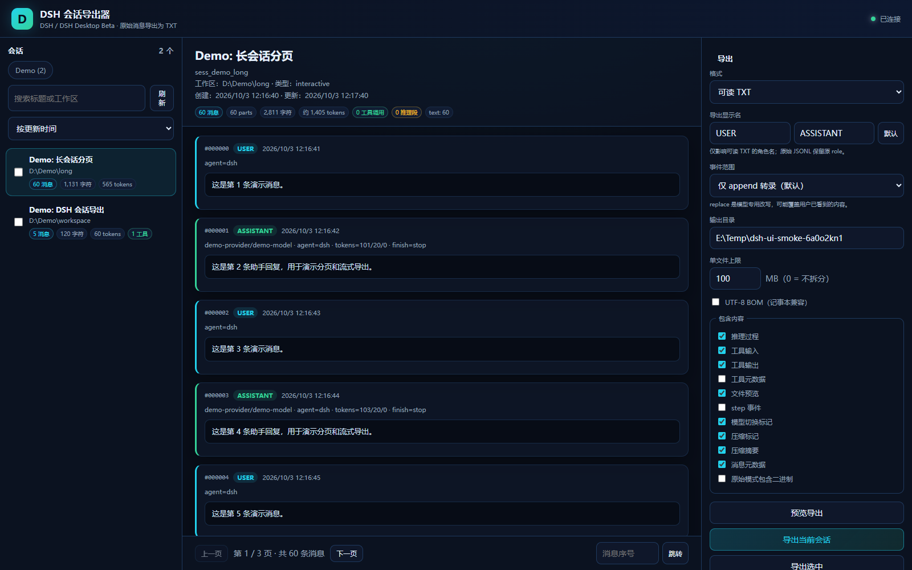

# dsh-session-exporter

[](https://github.com/Dongmingyue-loss/dsh-session-exporter/actions/workflows/ci.yml)
[](https://github.com/Dongmingyue-loss/dsh-session-exporter/releases)

把 **DSH / DSH Desktop Beta** 的会话日志导出为可读 TXT 或规范化 JSONL。本地 Web GUI、分页预览、流式导出，适合几十万到百万级 token 的长会话。



DSH 把会话保存为 append-only 的 `session.vN.jsonl[.zstd]`。官方 `/export` 提供的是原始日志 ZIP；本工具补上“人可以直接读、可以分页看、可以改角色名”的导出体验，并且不改动 DSH 的任何数据。

## 功能

- 自动发现 DSH 会话目录，按最高 `session.vN` generation 读取
- 原生读取 `.jsonl`，以及多帧拼接的 `.jsonl.zstd`
- 会话列表：标题、工作区、消息数、字符数、估算 token
- 分页消息预览，支持百万级上下文，不会一次性把整个会话塞进浏览器
- 导出前预览，可自定义 `USER` / `ASSISTANT` 显示名
- 三种 surface 事件范围：`append`、`append+replace`、`replace`
- 可读 TXT 与规范化 JSONL；支持 UTF-8 BOM、单文件拆分、进度/取消/下载
- 只读访问；缓存写在工具自己的目录，不写入 DSH 目录
- 无云端依赖，所有处理都在本机

## 快速开始

需要 Python 3.9+。

```bash
git clone https://github.com/Dongmingyue-loss/dsh-session-exporter.git
cd dsh-session-exporter

# Python 3.9-3.13：安装可选 zstd 解码器
python -m pip install -r requirements-dsh.txt

python app.py
```

Windows 也可以双击 `start.cmd`；macOS / Linux 使用 `./start.sh`。

启动后浏览器会打开一个带临时 token 的本地地址，例如：

```text
http://127.0.0.1:3220/?token=...
```

默认导出到 `~/Documents/DSH-Session-Exports`。

### 没有 DSH 数据？

```bash
python app.py --demo
```

`--demo` 只加载仓库内合成的 DSH v4 会话，不读取真实数据。

## 适用版本与系统

| 项目 | 支持范围 |
|---|---|
| DSH / DSH Desktop Beta | 当前 v4 JSONL / Zstd 会话格式；兼容 v0-v4 generation 选择 |
| Windows | Windows 10/11，本机实测 + GitHub Actions |
| macOS | macOS 13+，GitHub Actions 真实 runner |
| Linux | Ubuntu 22.04，GitHub Actions 真实 runner |
| Python | 3.9 / 3.12 / 3.14 CI 矩阵 |
| zstd | Python 3.14+ 使用标准库；3.9-3.13 安装 `requirements-dsh.txt` |
| 浏览器 | Chrome / Edge / Firefox / Safari |

DSH 格式仍在演进。遇到新 generation 或新事件类型时，工具会优先选择最高版本文件，并把未知事件保留在原始 JSONL 中；可读 TXT 会忽略无法识别的日志事件。

## 数据位置

按顺序自动发现：

| 来源 | 路径 |
|---|---|
| DSH Beta | `~/.dsh-beta/sessions` |
| DSH | `~/.dsh/sessions` |
| 自定义 | `--dsh-sessions /path/to/sessions` |
| 环境变量 | `DSH_SESSIONS_DIR` |
| Demo | `demo/dsh-sessions` |

目录结构：

```text
<DSH_HOME>/sessions/
  --<normalized-cwd>--/
    <session-id>/
      session.v4.jsonl.zstd
```

## 事件范围（surface modes）

DSH 的 surface 事件通过 `surfaceOp` 区分：

| 模式 | 导出内容 | 适用场景 |
|---|---|---|
| `append`（默认） | 只导出 `surfaceOp=append` 的持久人类转录 | 最接近用户实际看到的会话 |
| `append+replace` | append 与 replace 都导出，replace 单独标记 | 审计、调试改写过程 |
| `replace` | 只导出 replace / 模型专用事件 | 查看模型实际看到的改写版本 |

`replace` 是模型专用的上下文改写，可能覆盖用户已经看过的内容。默认 `append` 最安全；三种模式都会在导出报告中写明。

## 导出格式

### 可读 TXT

包含会话头、消息序号、角色、时间、模型/usage 元数据，以及：

- 用户 / 助手文本
- 推理过程（可关闭）
- 工具调用、输入、输出、状态
- 文件 / 图片引用（不打包二进制）
- 模型切换、上下文压缩、压缩摘要
- step 事件（可选）
- notice（异常/尝试失败等提示）

### 规范化 JSONL

每条消息一行，字段与会话预览一致；原始事件不直接透传。需要完整原始日志时，请使用 DSH 官方 `/export`。

## 命令行

```text
python app.py [options]

--host 127.0.0.1         仅允许 loopback
--port 3220              起始端口，自动向后寻找可用端口
--dsh-sessions PATH      DSH sessions 目录
--cache-dir PATH         规范化缓存目录
--demo                   只使用内置 Demo 会话
--output-dir PATH        导出目录
--token TOKEN            固定访问 token（默认随机生成）
--no-open                不自动打开浏览器
--version                打印版本
```

## 缓存

首次打开会话时，工具会流式解码并归一化到本地 SQLite 缓存，之后分页和导出直接读缓存。

| 系统 | 默认缓存目录 |
|---|---|
| Windows | `%LOCALAPPDATA%\dsh-session-exporter\cache` |
| macOS | `~/Library/Caches/dsh-session-exporter` |
| Linux | `$XDG_CACHE_HOME/dsh-session-exporter` 或 `~/.cache/dsh-session-exporter` |

缓存 key 包含源文件 realpath、mtime、size、surface mode 和 schema version。源文件变化会自动生成新缓存；旧缓存可以直接删除。

## 隐私与安全

- 只读 DSH 会话文件，不修改 DSH
- HTTP 服务只绑定 `127.0.0.1`，除 `/api/health` 外都要求 token
- 不记录消息内容，日志只保留请求路径和状态码
- 导出文件可能包含敏感对话、工具输出和文件路径，请自行保管
- 仓库不包含真实会话数据；Demo 全部为合成内容

## 已知限制

- 附件只导出引用和元数据，不打包原始字节；需要附件请使用官方 `/export`
- `replace` 语义依赖 DSH 当前格式；未来格式变化可能需要更新归一化逻辑
- 超大会话首次打开需要完整解码一次，之后走缓存
- 可读 TXT 会跳过纯日志事件（如 `step/*` 默认不显示，可在导出选项中开启）

## 开发与测试

```bash
python -m venv .venv
.venv/Scripts/python -m pip install -r requirements-dev.txt   # Windows
# .venv/bin/python -m pip install -r requirements-dev.txt     # macOS / Linux

python scripts/make_demo_sessions.py
python -m unittest discover -s test -v
python test/ui_smoke.py
ruff check --select E9,F .
python scripts/secret_scan.py
python scripts/package.py
```

CI 覆盖 Ubuntu 22.04、Windows、macOS × Python 3.9 / 3.12 / 3.14，并在三平台运行 Playwright GUI 冒烟测试。

## 文档

- [DSH 会话格式与缓存](docs/DSH-FORMAT.md)
- [架构](docs/ARCHITECTURE.md)
- [安全策略](SECURITY.md)
- [贡献指南](CONTRIBUTING.md)
- [变更记录](CHANGELOG.md)

## License

MIT
